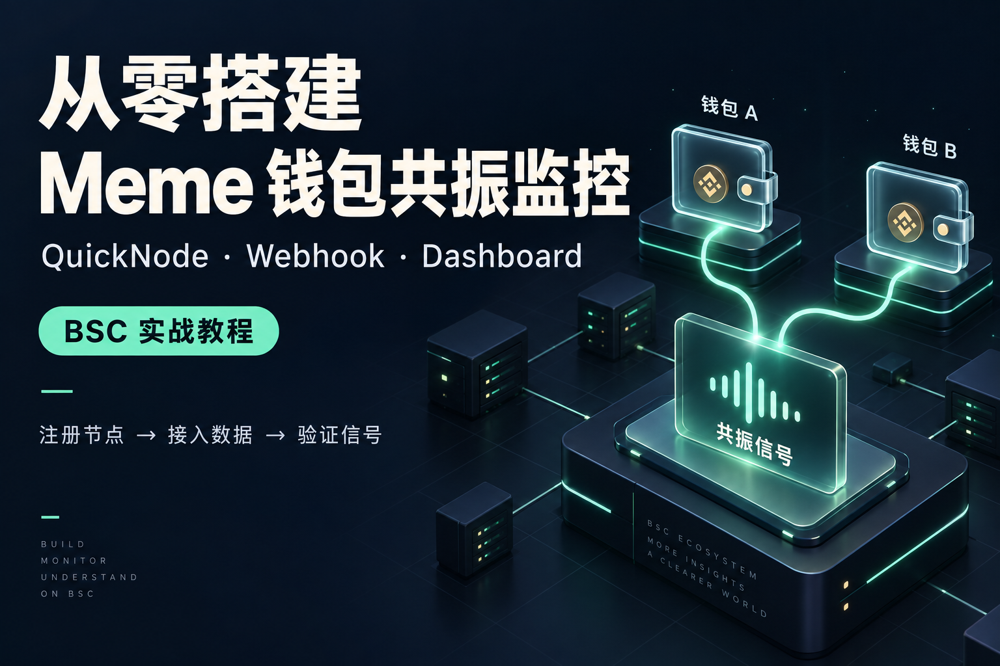
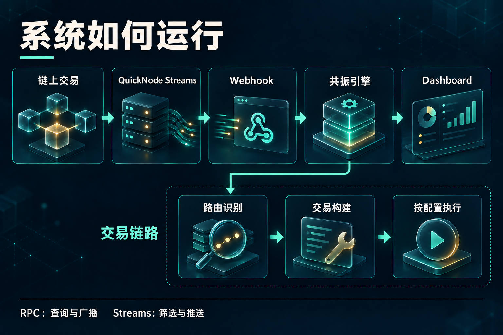
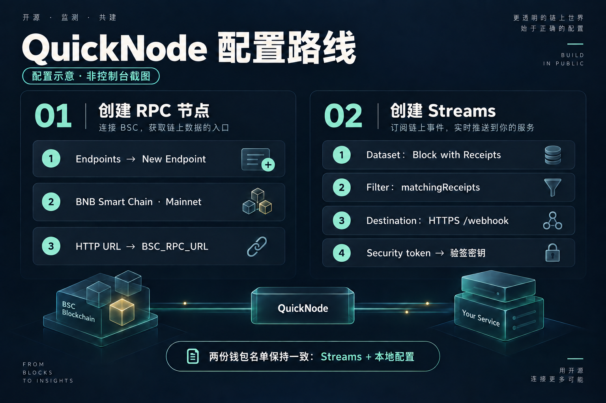
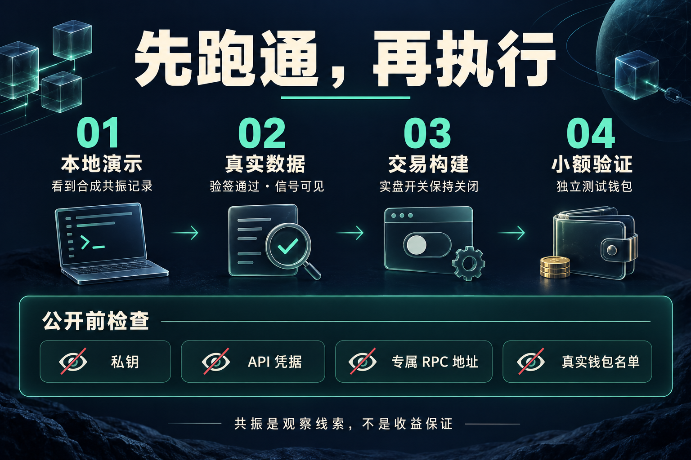

# Meme 钱包共振监控与交易执行器

仓库：https://github.com/haiyao-xiaohu/wsauto



当前实现的是安全默认的最小交易闭环：

1. 接收链、目标代币和买入金额。
2. 调用 OKX Trade API v6 获取路由与交易数据。
3. 检查 honeypot 标记、代币税率和价格影响。
4. dry-run 输出耗时与路由摘要。
5. 只有两个实时交易开关同时为 `true` 时才签名和广播。

覆盖 Ethereum、BSC、Base、Robinhood Chain 和 Solana。默认只支持使用
原生币买入代币，因此暂时不涉及 ERC-20 approve。

## 安装

```bash
npm install
cp .env.example .env
```

填写 `.env` 后，以 BSC 为例执行：

```bash
npm run trade -- \
  --chain bsc \
  --to 0x目标代币地址 \
  --amount 0.001 \
  --slippage 1
```

默认 `LIVE_TRADING=false`，命令只会请求和验证交易数据，不会广播。
此模式只需要填写公开的 `EVM_WALLET_ADDRESS`，无需填写私钥或 RPC。

## BSC 延迟基准

在真实交易关闭时，可运行同一进程、连接复用的 OKX 路由压测：

```bash
npm run benchmark:bsc
```

压测会先做一次 warm-up，再执行五次 dry-run `/swap` 请求；不会签名或广播。
生产监控与执行必须运行在同一常驻进程中，避免每个信号重新启动 Node
和重新建立 DNS/TCP/TLS 连接。

## BSC 双钱包共振

第一版规则：

- 上游系统已筛选可靠钱包时，直接统计上游传入的钱包。
- 如需本地二次限制，可选配置 `BSC_WATCH_WALLETS` 白名单。
- 任意两个不同钱包在 30 秒内成功买入同一代币时触发。
- 同一钱包重复买入只计一次，Webhook 重试按交易哈希去重。
- 每个代币触发后默认冷却 10 分钟。
- 使用链上区块时间；超过 15 秒的旧信号不会触发实时处理。
- 默认只记录信号；可按配置启用交易构建和真实执行。BSC 共振路由支持 Four.meme / Flap.sh 内盘及已识别平台的毕业代币。

先回放已有日志验证规则：

```bash
npm run replay:webhook
```

未配置 `BSC_WATCH_WALLETS` 时，回放命令会把日志里的全部钱包作为演示样本；
常驻 Webhook 服务则信任上游已经完成钱包筛选：

```dotenv
# 两项均可留空；需要本地二次过滤或签名校验时再填写。
BSC_WATCH_WALLETS=
QUICKNODE_STREAM_SECRET=
```

启动接收服务：

```bash
npm run webhook
```

服务同时提供实时 Dashboard：

- Dashboard：`http://127.0.0.1:8080/`
- QuickNode Webhook：`http://127.0.0.1:8080/webhook`
- 状态接口：`http://127.0.0.1:8080/api/state`
- 健康检查：`http://127.0.0.1:8080/health`

QuickNode Webhooks 的公网 Destination 应指向 `/webhook`。当前正式接收器读取 `matchingReceipts` 格式（真实日志不随仓库发布）：只把成功交易中直接流入
交易发起钱包、且不是 USDT/USDC/WBNB 等计价资产的代币识别为候选买入。

配置 `QUICKNODE_STREAM_SECRET` 后，服务会验证 `X-QN-*` HMAC-SHA256
签名；未配置时直接信任上游。

服务运行时可在另一个终端发送两条本地合成买入事件，验证 Dashboard 和
双钱包共振：

```bash
npm run demo:resonance
```

第一条事件只创建观察窗口，第二个不同钱包在 30 秒内买入同币时生成一条
共振记录。演示不会调用钱包私钥或广播链上交易。

默认 `RESONANCE_BUILD_SWAP=false`，共振时只记录触发事件。完成钱包白名单
与签名验证测试后，可设为 `true`，共振时根据代币平台和状态构建交易。保持全局与 Webhook 实盘开关关闭时，不会广播；各路由的风控能力有所区别。

## 必需资料

- OKX Developer Portal 的 Project ID、API Key、Secret Key、Passphrase。
- 一个专门用于测试、余额很低的新钱包。dry-run 只填公开地址；真实交易时私钥仅保存在本地 `.env`。
- 对应链的 HTTP RPC。后续做低延迟监控时还需要 WebSocket/交易流端点。
- 第一条测试链、目标代币地址和最大测试金额。

不要发送主钱包助记词或私钥到聊天。私钥只应由你本人写入本机 `.env`。

## 本地敏感配置

启动前复制 `.env.example` 为 `.env`，填写所需凭据及 `DASHBOARD_PASSWORD`（无默认密码）。钱包监控名单和黑名单需在本地自行准备；`test/wallet-book.sample.json` 仅含虚构示例。不要发布 `.env`、`logs/` 或个人钱包名单。

手动链上测试不再内置真实交易目标：按脚本要求通过 `TOKEN_ADDRESS`、`TEST_TX_HASH`、`TEST_WATCH_WALLET_1` 和 `TEST_WATCH_WALLET_2` 或命令行参数提供本地测试数据。

## QuickNode 接入

创建 BSC Mainnet RPC，完整 HTTP 地址写入本地 `BSC_RPC_URL`。Streams 使用 `Block with Receipts` 数据集；将 [过滤函数](docs/quicknode-bsc-filter.js) 复制到 QuickNode 编辑器，并在控制台替换虚构钱包名单。名单需与本地一致，真实名单不要提交到仓库。

Destination 指向公网 HTTPS `/webhook`，Stream 的 Security token 写入本地 `QUICKNODE_STREAM_SECRET`，重启服务后再恢复投递。过滤函数输出 `matchingReceipts`，并给日志补充 `blockTimestamp`。官方文档：https://www.quicknode.com/docs/streams/quickstart






